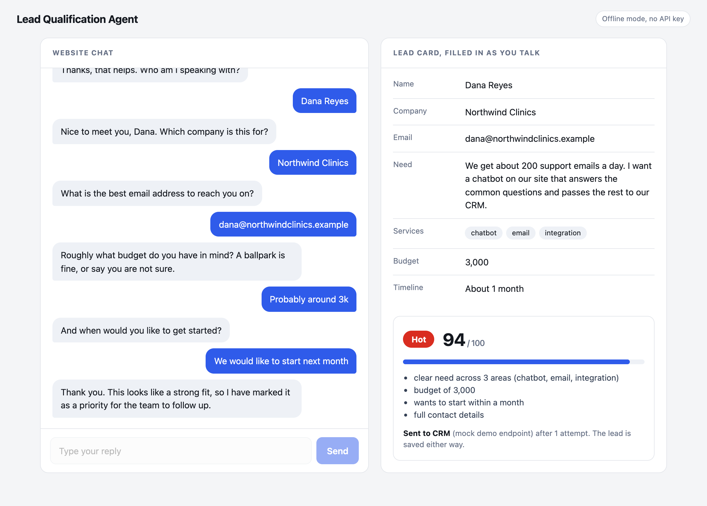
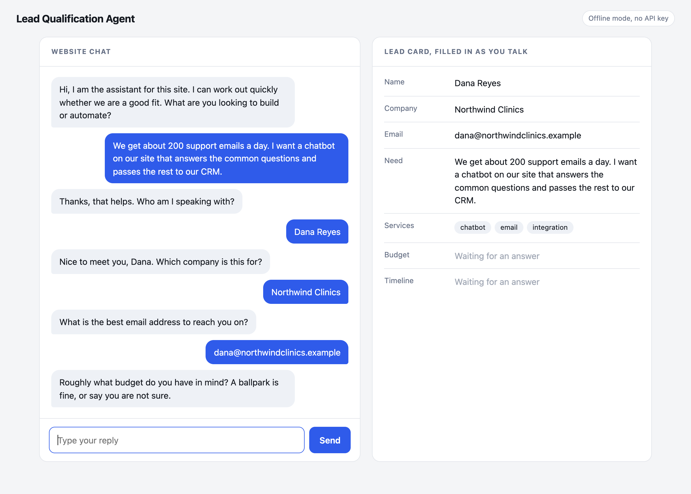

# Lead Qualification Agent

A chat assistant for a business website. It asks a visitor a few short questions, works out how good a lead they are, saves the lead and sends it to a CRM. The point is that the sales team opens a lead that already has a name, a need, a budget, a timeline and a score with the reasons written out.

The sample conversations here are invented. The company in the screenshots does not exist.

## What it looks like

The lead card on the right fills in while the visitor types. When the last question is answered, the lead is scored and sent on.





## How a conversation works

The assistant asks about six things: what they need, their name, their company, their email, their budget and their timeline. It reads every reply for all of them, so a visitor who writes "I'm Dana from Northwind, dana@northwind.io, we need a chatbot, budget 6k, starting next month" in one message is not asked the same things again.

The questions and the answers back are fixed text on purpose. The AI part of this project is understanding what people write, not improvising a conversation. That keeps the assistant on topic and means it cannot promise anything the business has not agreed to.

If an answer is unclear the assistant asks once more, then moves on. A visitor who will not give a name or budget still becomes a lead with the gaps noted.

## Scoring

Every point comes from a rule in `app/scoring.py`, and the reasons are saved with the lead so a salesperson can see why it got its label.

| Part | Points |
|---|---|
| Clear need | 25 for two or more areas, 18 for one, 5 if vague |
| Budget | 30 from 5,000, 24 from 2,000, 18 from 1,000, 10 from 500, 4 below that, 8 if not given |
| Timeline | 25 within a month, 15 within three months, 6 later, 8 if not given |
| Contact details | 12 for an email, 4 for a company, 4 for a name |

Hot is 70 or more, Warm is 45 to 69, anything lower is Cold. There is one hard rule: a lead with no email is held at Cold however high it scores, and the assistant says so honestly instead of promising a follow up nobody can make.

The numbers are a starting point. Change them to match how your business actually sells.

## Two ways to read replies

- **Offline.** Pattern matching in `app/extract_rules.py`. No API key and no cost. It handles the common ways of writing things (5k, $12,500, in 2 weeks, asap, within a month) but not every phrasing, and only English.
- **Claude.** If `ANTHROPIC_API_KEY` is set, `app/extract_llm.py` sends each reply to Claude with a JSON schema and reads the fields back. It copes with messier writing like "around five grand, live by spring". The default model is `claude-haiku-4-5`, set with `LEAD_MODEL`.

Three safeguards in the Claude path:

- An email is only kept if it is well formed and really appears in what the visitor typed, so the model cannot invent one.
- The visitor's reply is passed as data to read, not instructions to follow.
- If the API call fails for any reason, the offline rules answer instead, so a network problem does not end the conversation.

The page shows which mode is running in the top right corner.

## Sending the lead on

When a conversation finishes, the lead is saved to SQLite first and then sent to the CRM as a JSON webhook (`app/crm.py`):

- It retries server errors, rate limits and network failures up to three times, waiting 0.5 then 1 second between tries.
- It does not retry other client errors such as a 401, because that will never start working.
- Every request carries an `Idempotency-Key` header with the lead id, so a retry cannot create the lead twice in a CRM that supports it.
- If delivery fails, the lead is still saved and marked `failed`, so nothing is lost.

With no `CRM_WEBHOOK_URL` set, leads go to a small stand in CRM inside the app (`app/mock_crm.py`) that checks the idempotency key like a real one would. Point the setting at your own endpoint to use a real one.

## Run it

Built and tested with Python 3.13, FastAPI 0.142 and `anthropic` 1.11.

```bash
python3 -m venv .venv
source .venv/bin/activate
pip install -r requirements-dev.txt
python -m pytest                                  # 67 tests
python -m uvicorn app.main:create_app --factory   # then open http://127.0.0.1:8000
```

Settings, all optional:

| Variable | Default | Meaning |
|---|---|---|
| `ANTHROPIC_API_KEY` | none | Turns on Claude mode |
| `LEAD_MODEL` | `claude-haiku-4-5` | Model used in Claude mode |
| `LEAD_DB` | `data/leads.db` | SQLite file for finished leads |
| `CRM_WEBHOOK_URL` | none | Real CRM endpoint. Without it the stand in CRM is used |
| `SESSION_CAP` | 1000 | Unfinished conversations kept in memory |

## API

| Request | What it does |
|---|---|
| `POST /api/start` | Begins a conversation, returns the session id and the first question |
| `POST /api/chat` | Sends a visitor message (1 to 1000 characters). Returns the reply, the fields captured so far and, on the last message, the scored lead |
| `GET /api/leads` | Saved leads, newest first. Optional `?label=Hot`, `Warm` or `Cold` |
| `GET /api/leads/{id}` | One lead |
| `GET /api/health` | Mode and CRM target |

## Honest limitations

- **The Claude path has not been run against the live API for this project.** Its tests use a stand in client that returns prepared replies, which prove the request shape, the safeguards and the fallback. Try it with your own key before relying on it.
- **Unfinished conversations live in memory.** Restarting the server loses them. Finished leads are in SQLite. A real deployment would keep sessions in a database or Redis.
- **The leads endpoints have no login.** Anyone who can reach the server can read the leads. Put authentication in front before using it with real people.
- **No rate limiting.** A bot could open many conversations. Sessions are capped, but add rate limits before putting this on a public site.
- **Currency is not detected.** Budget amounts are compared as plain numbers against the thresholds in `scoring.py`, so set those for your own currency.
- **CRM delivery runs inside the request.** With three tries the visitor could wait a couple of seconds if the CRM is down. At volume, hand it to a queue and a background worker.
- **One conversation shape.** The six questions are fixed. A different business needs different questions, which means editing `conversation.py`, and probably the scoring rules too.
- **English only.**

## Project layout

```
app/main.py           the API and the page
app/conversation.py   which question comes next, when to stop, what to say
app/extract_rules.py  offline reading of replies
app/extract_llm.py    Claude reading of replies, with fallback
app/scoring.py        the score and the reasons
app/store.py          SQLite storage for leads
app/crm.py            webhook delivery with retries and idempotency
app/mock_crm.py       stand in CRM for the demo and tests
static/index.html     the chat page and lead card
tests/                pytest suite
```
